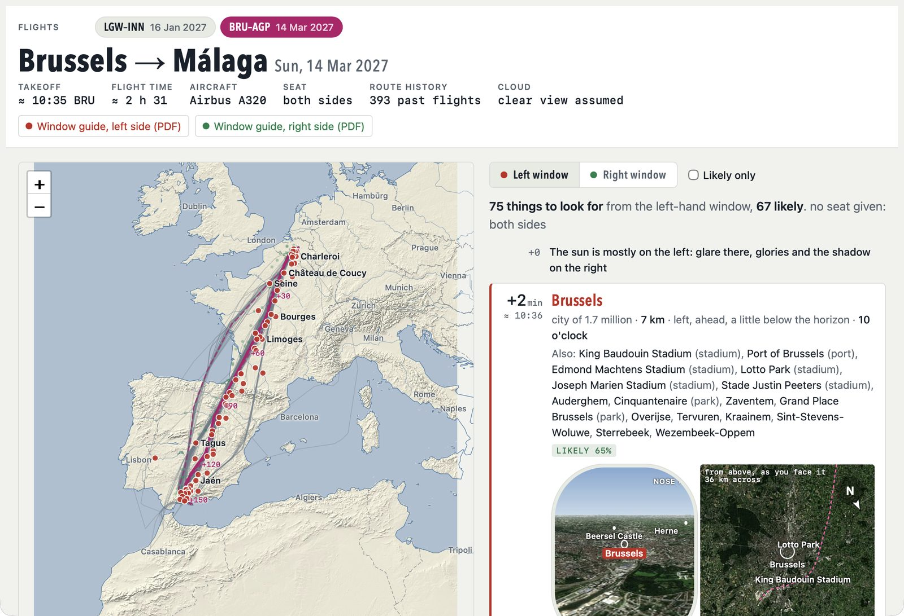
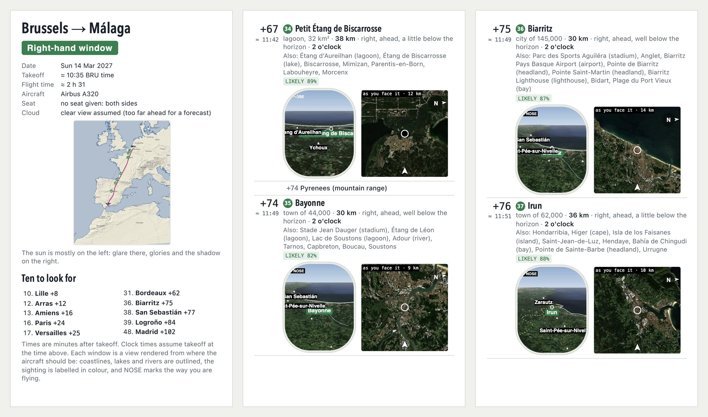
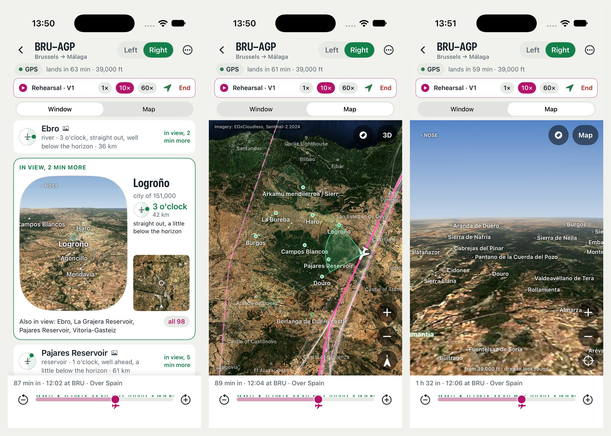
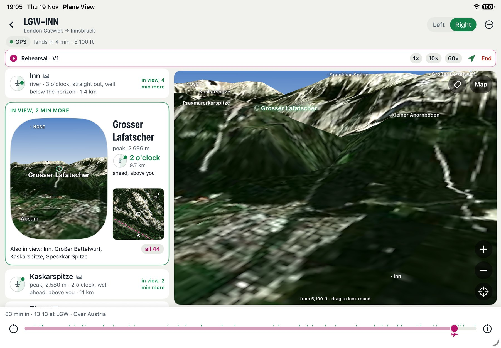

# plane-view

**What will I see from my window seat?**

Give plane-view a date, a flight and a seat, and it forecasts what you will be able to see out of the window:
which towns, mountains, lakes, coasts and landmarks, at how many minutes after takeoff, on which side, in which
direction, how far away, and how likely. It draws the view you should expect for each one.

It works by looking at where past flights on that route really went, using open aircraft-tracking data, and
working out what was in view from each of them.



## What you get

- **A web page** for your flights: the likely routes on a map, and a timeline for each side of the aircraft.
  Every sighting has a rendered **window view** and a **satellite image from above**. It is a plain folder of
  files that opens in any browser, offline, and can be put on any web host.
- **PDF guides**, one per side, sized for a phone: save one before you go.
- **An iPhone and iPad app** for the flight itself. It uses the device's GPS (which works in flight mode) to show
  what is in view right now and what is coming up, on a list, an offline map and a 3D view. It keeps working
  when GPS drops out, and when the flight takes a different route from the one forecast.
- **The data**, as JSON, for anything else you want to do with it.



*The PDF guide for the right-hand windows.*



*The app in flight over northern Spain: what is in view now, the map with the window's field of view, and the 3D view.*



*On an iPad the list and the map or 3D view share the screen. This is a high-detail flight pack, four minutes before landing at Innsbruck.*

See it without installing anything: the **[example forecasts](https://antimega.github.io/plane-view/)** for
Brussels to Málaga, London to Innsbruck and London to Phoenix. [examples/](examples/README.md) has how each was
made, and flight packs to download for the app.

## Quick start

You need macOS or Linux, [uv](https://docs.astral.sh/uv/) and `curl`. No account or API key.

```bash
git clone https://github.com/antimega/plane-view.git
cd plane-view
uv sync                                   # installs Python and the libraries
uv run planeview doctor                   # checks your setup and that the data sources answer
uv run planeview history update 3         # three recent days of past flights: about 4 minutes each
uv run planeview predict --date 2027-03-14 --from BRU --to AGP --dep 10:20
uv run planeview serve                    # then open http://localhost:8765/
```

Change the date, the airports (IATA codes) and the departure time (local time) to your own flight. Add
`--seat 23F` to forecast only your side and allow for the wing. Or give a flight number in place of
the airports: `--flight SN3733 --dep 10:20`.

The first forecast downloads place names, coastlines, terrain and imagery for the route, about 0.6 GB, and takes
around a quarter of an hour. After that a forecast on the same route takes a few minutes.

**More history makes a better forecast.** Three days is enough to try it on a busy route. For a route flown
once a day, or to see the less common routings, keep more: `uv run planeview history update 14`, or one day a
week over several months with `history add 2026-06-01..2026-10-31/7`. Each day kept is about 40 MB.

The full walk-through is in **[docs/getting-started.md](docs/getting-started.md)**.

## On the flight: the app

```bash
uv run planeview pack out/2027-03-14_BRU-AGP      # one file: out/packs/2027-03-14_BRU-AGP.planeview
```

Build the app with Xcode (free; `ios/PlaneView.xcodeproj`), AirDrop the pack to your iPhone or iPad, and open it
before you board. In the air it needs no network. **[docs/app.md](docs/app.md)** covers building, loading
flights and using it.

## Commands

| Command | What it does |
|---|---|
| `planeview doctor` | check tools and data sources |
| `planeview history update [N]` | add whichever of the last N days of flights you do not have |
| `planeview history add DAYS` | add chosen days: `2026-11-09`, `A..B`, or `A..B/7` for one day a week |
| `planeview history status` | what your route library holds |
| `planeview pairs [--min 5]` | airport pairs you have past flights for |
| `planeview predict --date D (--flight F \| --from A --to B) [--dep HH:MM] [--seat 23F]` | forecast a flight; builds the page and PDFs |
| `planeview serve [PORT]` | serve the page at `http://localhost:8765/` |
| `planeview site` | rebuild the page from every flight built |
| `planeview build out/<id>` | rebuild one flight's pictures, page data and PDFs |
| `planeview pack out/<id> [--detail high]` | make a flight pack for the app |
| `planeview landmarks --from A --to B` | fetch every landmark along a long route in one go |

Run each as `uv run planeview ...`. `uv run planeview <command> --help` lists the options.

## How it works, in short

1. **Past flights.** [adsb.lol](https://adsb.lol) publishes every aircraft position its volunteers' receivers
   hear. plane-view keeps a compact library of the flights on the days you choose.
2. **Likely routes.** Past flights between your two airports are weighted (same flight number, airline, time of
   day) and grouped into route variants with probabilities.
3. **What is on the ground.** Places from GeoNames and Natural Earth, landmarks from Wikidata.
4. **What is in view.** From every point of every past flight: distance, direction, angle below the horizon on a
   curved Earth, apparent size, haze, daylight, whether terrain is in the way, and whether it falls in the part
   of the view a window gives you.
5. **The timeline.** The chance of seeing something is the share of past flights it was in view from. The best
   sighting for each few minutes is the headline; the rest are listed with it.
6. **Pictures.** Each headline sighting is rendered from the aircraft's predicted position: terrain from the
   Copernicus elevation model, coloured from cloud-free Sentinel-2 satellite imagery.

More in **[docs/how-it-works.md](docs/how-it-works.md)**.

## What it cannot do

- It forecasts the **usual** routes. The route on the day is up to air traffic control and the weather. The
  forecast gives the alternatives and their odds, and the app follows whichever one you end up on.
- It assumes a **clear view**. Cloud is shown as an outlook within 15 days, and can be folded into the odds with
  `--cloud full`, but nobody can forecast cloud for a flight months ahead.
- With **little history** for a route the forecast is a guess. With none, it follows the great circle.
- Over **oceans** there is no tracking data and nothing to name.

## Documentation

| | |
|---|---|
| [Getting started](docs/getting-started.md) | install, get history, forecast, settings |
| [How it works](docs/how-it-works.md) | each step of the forecast and its limits |
| [The web page](docs/web-page.md) | what is on it, rebuilding it, hosting it, the PDF guides |
| [The app](docs/app.md) | using, building, loading flights, how it finds its position, testing |
| [Flight packs](docs/flight-packs.md) | making them, high detail and what it looks like, the file format |
| [Data sources](docs/data-sources.md) | every source, its licence, and what that means for what you share |
| [Examples](examples/README.md) | three flights, with commands, results and downloads |
| [Troubleshooting](docs/troubleshooting.md) | when something does not work |

## What is in the repository

```
planeview/         the forecaster, a Python package
  sources/         past flights, airports, flight numbers, landmarks
  output/          the web page, the PDF guides, the maps
  web/             the page's template and its map library
ios/               the app: an Xcode project, and a Swift package with its logic
tests/             unit tests: uv run pytest
tools/             a check of the app's logic against the forecaster
docs/  examples/   documentation
```

Everything downloaded goes in `cache/`, forecasts and packs in `out/`, and the web page in `site/`. None of the
three is part of the repository.

## Licence

The code is under the [MIT licence](LICENSE).

The data it downloads belongs to its sources, and what you build from it carries their terms. In particular the
satellite imagery is CC BY-NC-SA 4.0, so pages, PDFs and flight packs are for **non-commercial use, with
attribution**. The details are in [docs/data-sources.md](docs/data-sources.md).
