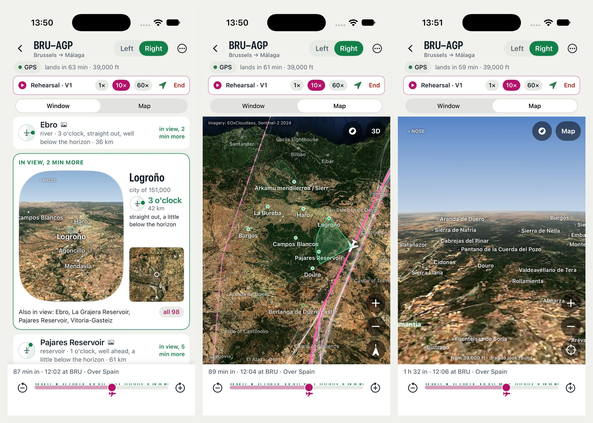
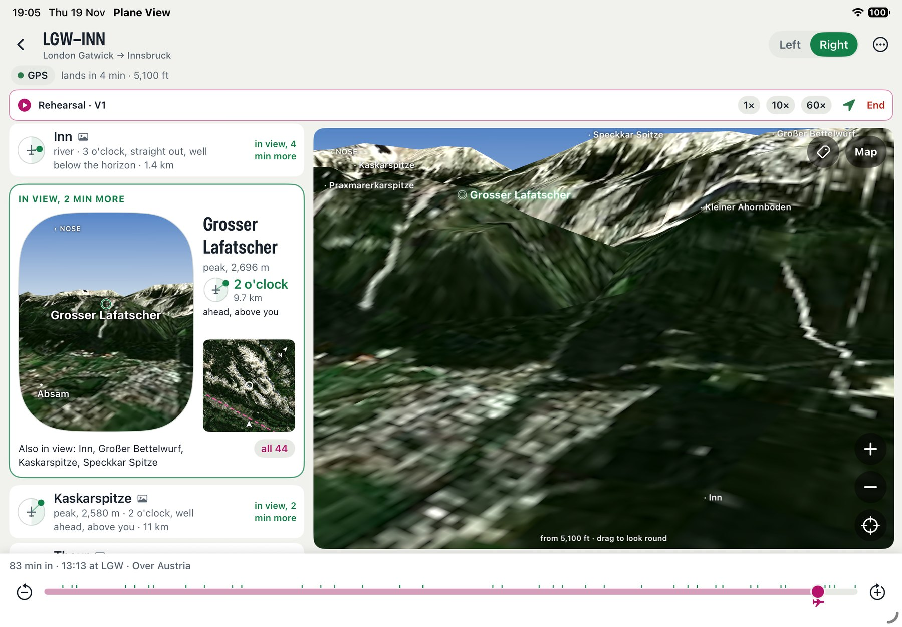
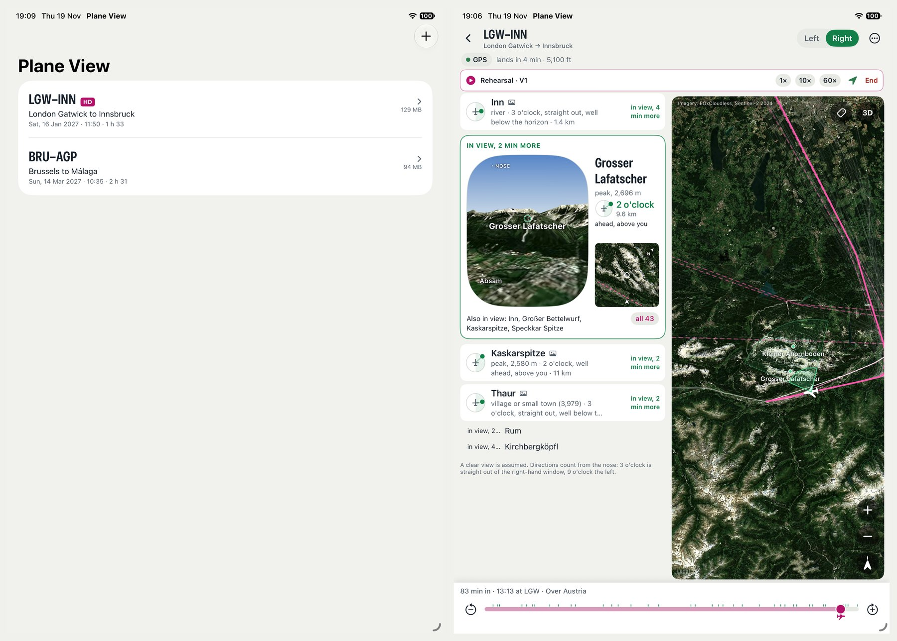

# Plane View: the iPhone and iPad app

The app is the forecast for the flight itself: what is out of your window now, what is coming up and when, and
where to look. Everything it needs is in one file you load before you leave. It never uses a network.



It is not in the App Store. You build it yourself with Xcode, which is free, and takes about ten minutes the
first time.

- [Using it](#using-it)
  - [On an iPad](#on-an-ipad)
- [Building it](#building-it)
- [Getting a flight onto the device](#getting-a-flight-onto-the-device)
- [How it works](#how-it-works)
- [Testing](#testing)

## Using it

**Before the trip**, on your computer:

```bash
uv run planeview predict --date 2027-03-14 --from BRU --to AGP --dep 10:20 --seat 23F
uv run planeview pack out/2027-03-14_BRU-AGP
```

That writes `out/packs/2027-03-14_BRU-AGP.planeview`: 30 to 80 MB for a flight within Europe, several hundred
for long haul. Put it on the device (see
[below](#getting-a-flight-onto-the-device)), open the flight once before boarding, and allow location, and
notifications if you want the alerts.

To try the app without making a forecast, download one of the [example packs](../examples/README.md).

**In the air**

- **Window** is the flight's sightings on your side as a vertical list, in the order they come. The one to look
  at is the large card: the sighting in view nearest its best moment, or the next to come when nothing is in
  view. It has a rendered window view with the names lettered on it, the clock direction ("2 o'clock, a little
  below the horizon"), the distance, how much longer it stays in view, and what else is in view. Its neighbours
  keep a line or two; further off they shrink to a time and a name, with coast and border crossings between.
  Everything already passed is a scroll up, everything to come a scroll down, and *Back to what's in view*
  returns. Tap a sighting for its window view, the image from above turned the way you face it, and the numbers.
- **Map** is an offline satellite map, north up: every route past flights took, the path being flown, the
  aircraft, the wedge of ground your window faces, and names for what is in view and what comes next. Pinch,
  double-tap or use + and − to zoom. A drag stops the map following the aircraft; the arrow button brings it
  back.
- **The tag button** on the map and in 3D sets how many places are named: the best of what is in view; those and
  the notable places around, to get your bearings by; or as many as fit.
- **3D**, the button on the map, is the view out of your window from where the aircraft is: the satellite
  imagery laid over the terrain on a curved Earth, the sighting in focus ringed, the best of what is in view
  named. Drag to look round, pinch or use + and − to zoom, double-tap to look straight out again.
- **Every sighting has two pictures**: the window view and the map from above. The forecast's own are used for
  its headline sightings on its likely route. For everything else the app draws them itself, from the 3D scene
  and the pack's map; those take a moment the first time and are plainer. Touch a picture and it fills the width
  of the screen until touched again.
- **The bar along the bottom** is the flight as a tape. Drag it, or step a minute at a time, to look back ("what
  was that three minutes ago?") or ahead. *Back to now* returns.
- **The chip at the top left** says where the position comes from: *GPS*; *GPS 4 min old · est. ±1 min*, carried
  forward along the route at the speed last measured; *Set by you*; or *Timetable*, when there is nothing better
  yet. With no GPS, tap *Wheels up now* at takeoff, or scroll to where you really are and tap **We're here**. A
  GPS fix, whenever one comes, takes over.
- **Outside the app**, in Camera or Maps, the Dynamic Island and the Lock Screen show the next sighting with a
  countdown, and a banner comes about a minute before each headline sighting. GPS keeps logging in the
  background, shown by the blue location pill.
- **Afterwards**, *Photos from this flight* lists every photo taken during the flight with where the aircraft was
  and what was in view, can write the position into photos that have none, and exports the list. *Export the GPS
  track* gives a GPX file.
- **Rehearse this flight** flies any of the pack's routes through the app at up to 60 times speed, with a switch
  to turn its GPS off. Use it to look through a flight at home, or to try the app.

**GPS in an aircraft.** A phone held near the window usually gets a fix within a minute or two; away from the
window it often gets none. Flight mode does not turn GPS off. The app is built to work with a fix that comes and
goes.

### On an iPad

The list and the map share the screen, in portrait and landscape, so there is no switching between *Window* and
*Map*: the sightings stay on the left while the map or the 3D view fills the rest.



*An iPad in landscape, four minutes before landing at Innsbruck: the list beside the 3D view.*



*In portrait: the list of flights, and a flight open with the list beside the map.*

Only an iPad with cellular has GPS; a Wi-Fi one runs on *Wheels up* and *We're here* alone.

The larger screen shows more of each picture and of the map, so it is where a high-detail pack helps most. The
screenshots above are of one: **HD** beside the flight in the list says so. It is sharper on a phone as well:
[flight-packs.md](flight-packs.md#what-the-difference-looks-like) has the two side by side.

## Building it

You need a Mac with Xcode, and an Apple ID. A free Apple ID is enough to run the app on your own device (a free
one must be re-installed every seven days; a paid developer account lasts a year). The app needs iOS or iPadOS
18 or later. It was developed with Xcode 27; an older Xcode that has the iOS 18 SDK should work but is untested.

**1. Tell the project who you are.** Signing is kept out of the project file, in one small file that is not
checked in:

```bash
cp ios/Config/Local.xcconfig.example ios/Config/Local.xcconfig
```

Edit `ios/Config/Local.xcconfig` and set the two values:

```
DEVELOPMENT_TEAM = ABCDE12345          your 10-character Team ID
PLANEVIEW_BUNDLE_PREFIX = com.yourname   any reverse-domain prefix that is yours
```

Your Team ID is at developer.apple.com/account under Membership details. With a free Apple ID, add the account in
Xcode (Settings › Accounts) and pick it once in the target's Signing & Capabilities pane; Xcode shows the ID
there.

**2. Build and run.**

```bash
open ios/PlaneView.xcodeproj
```

Choose the **PlaneView** scheme and your device, and press Run. The first time, the device asks you to trust the
developer: Settings › General › VPN & Device Management.

To run in the Simulator no signing is needed, so step 1 can be skipped.

The project file is generated from `ios/project.yml` by [XcodeGen](https://github.com/yonaskolb/XcodeGen) and is
checked in, so Xcode opens it as it is. Only after adding or removing source files:

```bash
cd ios && xcodegen
```

## Getting a flight onto the device

A pack is one `.planeview` file. Any of these works:

- **AirDrop** it to the device and choose Plane View.
- **iCloud Drive**: `uv run planeview pack out/<id> --icloud` (on a Mac) also copies the pack to
  iCloud Drive › PlaneView. In the app tap **+** and pick it. Do this on the ground: it has to download.
- **Files**: put it in Files › On My iPhone › Plane View, by cable from Finder or any other way. The app unpacks
  whatever it finds there.
- **Simulator**: copy it into the app's Documents folder:

  ```bash
  cp out/packs/2027-03-14_BRU-AGP.planeview "$(xcrun simctl get_app_container booted com.example.planeview data)/Documents/"
  ```

A flight marked **HD** in the list came from a high-detail pack. The app keeps one copy of each flight, the last
one added.

## How it works

The pack does not carry a timeline for the app to play back. It carries a model: every route past flights took,
and the ground for 60 km either side of all of them. The app works out the view itself, from wherever the
aircraft turns out to be, with a Swift port of the forecaster's visibility model (same window cone, haze, sizes,
night rules and terrain sight lines).

- **Where are we?** Each GPS fix is matched against all the tracks at once: a smoothed misfit in distance and
  heading for each, plus a little of the forecast's prior. The best match is the route being followed.
- **The path being flown** is that track bent through where the aircraft actually is: the past is what the GPS
  logged, the next few minutes follow the present course, and after that the offset eases back to the track.
  Sightings for the whole flight are worked out along this path, and again whenever it moves by 3 km, changes
  track, or every 90 seconds.
- **Stale GPS.** With no fresh fix the position is carried along that path at the pace last measured, with an
  uncertainty that grows with the time since the fix. The list then also shows what is in view a little earlier
  or later, and the map draws how far along the aircraft might be.
- **Another routing.** A flight on the second-likeliest variant, or on one flown once last winter, is matched to
  that track. One that is on none of them still gets a list, because the view is worked out from the fix and the
  pack covers the ground well beyond. The app says how far it is from any route past flights took, and when it
  is beyond the pack's reach.
- **Slow, late, held.** Times are plan time and countdowns are divided by the pace, so a slow cruise stretches
  them. With no GPS at all, *Wheels up* or *We're here* is the anchor.

| Where | What |
|---|---|
| `ios/PlaneViewCore/` | Swift package with no UI, which also builds on macOS: `Pack` (and a small ZIP reader), `Geo`, `FlightPath`, `Spotter` (visibility), `Navigator` (position), `FlightModel` (what to show at any moment). `pvcore` is its command-line twin |
| `ios/PlaneView/App/` | `FlightSession` (one open flight: clock, GPS, rehearsal), `LocationFeed`, `TrackLog`, `Announcer` (Live Activity, banners), `PhotoMatcher`, `PackLibrary`, `Art` (the app's own pictures) |
| `ios/PlaneView/Views/` | the flight list, the flight screen, the window list, the map, the 3D view (`WindowScene`, SceneKit), the bar, the sheets |
| `ios/PlaneView/Widget/` | the Live Activity |

## Testing

**The core against the forecaster**, on a Mac, with no device:

```bash
uv run python tools/check_app_core.py out/packs/2027-03-14_BRU-AGP.planeview
```

This builds the Swift core, works out every sighting along a route twice (in Python and in Swift) and compares
them, then replays the route as a flight four ways: with GPS throughout, with a 25-minute GPS gap, 45 km off any
route flown, and with no GPS and a departure 25 minutes late. It takes several minutes on a
pack with tens of thousands of features.

**The app in the Simulator**, from the command line:

```bash
xcodebuild -project ios/PlaneView.xcodeproj -scheme PlaneView -destination 'platform=iOS Simulator,name=iPhone 17' -derivedDataPath ios/build build
xcrun simctl install booted ios/build/Build/Products/Debug-iphonesimulator/PlaneView.app
xcrun simctl launch booted com.example.planeview -liveActivity NO -rehearse V1 -rate 30
```

Launch arguments, all optional:

| Argument | What |
|---|---|
| `-open <flight id>` | open that flight (otherwise the last one open) |
| `-rehearse V1` | fly a route through the app: `V1` is the likely route, `V2`... the other variants, `H1`... past flights |
| `-rate 30` | rehearsal speed |
| `-from 600` | start the rehearsal this many seconds after takeoff |
| `-shift 45` | fly it this many kilometres to one side, as a routing nobody has flown |
| `-side L` or `R` | the window |
| `-tab map` | open on the map |
| `-liveActivity NO` | no Lock Screen activity. Use this for repeated Simulator launches: restarting an app with an activity up can crash the Simulator's activity renderer |

Do not make a high-detail pack while the Simulator is running. The render is heavy, and Simulator apps starved
of processor time are stopped by the system.

## What it does not do

- No camera: the device's own Camera is better, and the app is made to work beside it.
- No cloud: a clear view is assumed, as in the forecast.
- No compass: it is unreliable in an aircraft, so there is no "point the phone at it". Directions are clock
  positions from the nose.
- The app's own pictures are plainer than the forecast's: no slope shading, snow or town lights.
