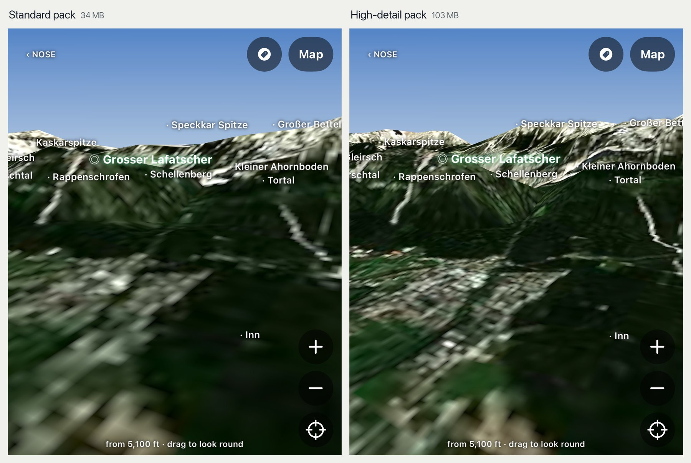
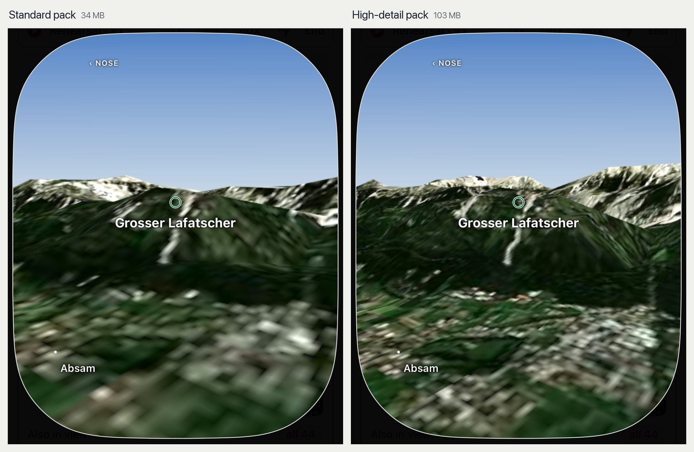
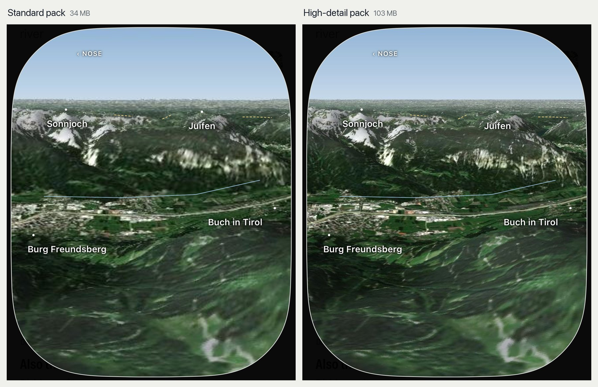
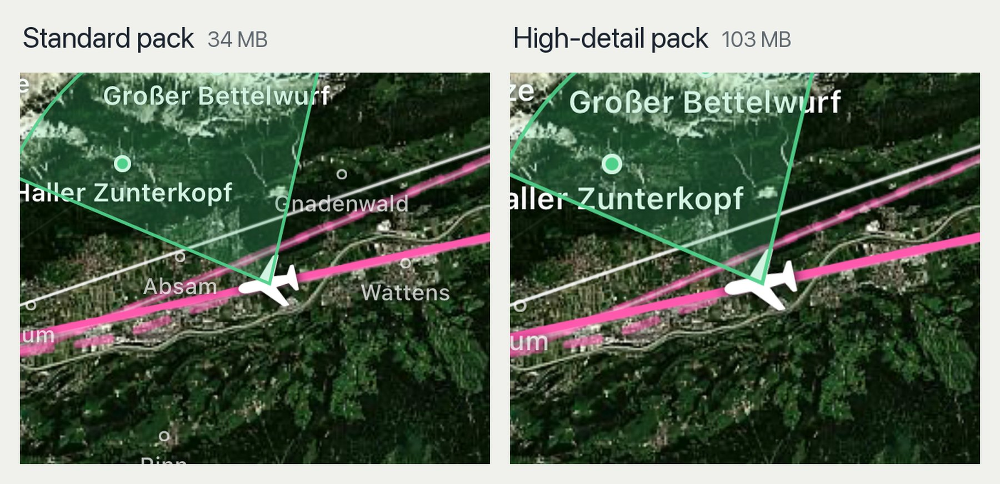

# Flight packs

A flight pack is one file, `<id>.planeview`, holding everything the [app](app.md) needs for one flight with no
network: the routes, the ground, the pictures, a map and the terrain.

## Making one

```bash
uv run planeview pack out/2027-03-14_BRU-AGP               # out/packs/2027-03-14_BRU-AGP.planeview
uv run planeview pack out/2027-03-14_BRU-AGP --icloud      # ... and a copy in iCloud Drive/PlaneView (macOS)
uv run planeview pack out/*/                               # every forecast you have
```

A pack is made from a saved forecast (`out/<id>/prediction.json`) and the pictures already built for the web
page. The first pack for a route downloads its map tiles and some terrain, and takes a few minutes; after that
it is quick.

Size depends on how long the flight is and how widely past flights spread: about 30 to 80 MB for a flight within
Europe.

**Long haul is another order.** A London to Phoenix pack is about 370 MB, nearly all of it map: 40,000 tiles
covering every track past flights took across the Atlantic and the Arctic. Its first build downloads those
tiles and the terrain for the whole corridor, and takes an hour or more. `--no-map` or `--relief cached` skip
one or the other when that is too much.

| Option | What it does |
|---|---|
| `--detail high` | a sharper, larger pack: see [below](#detail) |
| `--icloud` | also copy the pack to iCloud Drive › PlaneView |
| `--reach 60` | how far outside every past flight the pack still knows the ground, in km |
| `--no-map` | leave the satellite map out (a much smaller pack; the app's map and 3D view are then bare) |
| `--landmarks on` | ask Wikidata for landmarks across the whole widened corridor. By default only cached answers are used |
| `--relief cached` | do not download terrain for the 3D view; use what is cached. It is flat where none was |

## Detail

`--detail high` writes `<id>-hd.planeview`: a sharper map, sharper pictures and finer terrain, for an iPad or
for a phone with room to spare.

| | Standard | High |
|---|---|---|
| Map | whole reach to zoom 9, the flown band at 10, near the airports at 11 | one zoom deeper everywhere: 10, 11 and 12 |
| Forecast pictures | 320×400 and 320×320 | re-rendered at 640×800 and 640×640 |
| Terrain for the 3D view | about 1.4 km a cell | about 360 m a cell |
| Size | 1× | about 3× |

It is a long render: every picture is drawn again at four times the pixels. It runs at low priority on half the
processor cores, so the computer stays usable. A 90-minute flight takes about ten minutes on an eight-core
laptop; a longer flight, with more sightings, takes proportionally longer.

The app shows **HD** beside a flight loaded from a high-detail pack. It keeps one copy of a flight, the last
added, so a high-detail pack replaces the standard one of the same flight and the other way round.

### What the difference looks like

These are the two packs of the [London Gatwick to Innsbruck example](../examples/README.md) on an iPhone, at the
same moment of the same rehearsal: 83 minutes in, at 5,100 ft in the Inn valley, four minutes before landing,
looking out of the right-hand window. Nothing differs but the pack.

**The 3D view** gains the most. The terrain is four times finer each way, so ridges and gullies have their
shape, and the map laid over it is a zoom level deeper, so the town below is streets and fields and not blocks.



**The pictures the app draws itself**, for sightings the forecast has no picture of, come from that same 3D
scene, so they gain as much. Here one is touched to fill the screen:



**The forecast's own pictures** are rendered at twice the size each way. On a phone that matters when one is
touched to fill the screen: the standard picture is stretched to more than three times its size, the
high-detail one to less than twice.



**The map** has one more zoom level. At the scale the app opens at there is little to tell them apart. It shows
once you zoom in, here to a strip of the valley about 13 km wide near the airport:



On a phone, then: worth it for a flight you will spend looking at the 3D view, over mountains or a coast, and
when you have the storage. For a flight over flat country at cruising height the standard pack loses little.
On an iPad, where every picture is larger, it is worth it more often: [app.md](app.md#on-an-ipad) has
screenshots.

## What is inside

A pack is an ordinary ZIP archive. Schema `plane-view/pack/1`.

```
pack.json            the flight, the routes, the forecast's sightings, and what the rest of the pack holds
features.json        every named thing that could come into view
views/L/000.jpg      the forecast's window view for each headline sighting, by side and number
aerial/L/000.jpg     ... and its image from above
tiles/8/126/85.jpg   the offline satellite map, as standard web map tiles (z/x/y)
dem/N50E004.i16      terrain for sight lines, one file per 1° cell
relief/N50E004.i16   terrain for the 3D view, one file per 1° cell
```

The pack is a model of the flight and the ground around it, not a list to play back. It carries **every** route
past flights took and **everything** that could be seen from within 60 km of any of them, so the app can work
out the view from wherever the aircraft actually is.

### pack.json

| Key | What |
|---|---|
| `schema` | `"plane-view/pack/1"` |
| `id` | the flight's id, e.g. `2027-03-14_BRU-AGP` |
| `generated` | when the pack was made (UTC) |
| `detail` | `"standard"` or `"high"` |
| `flight` | number, airline, date, `orig` and `dest` (code, name, position, time zone), aircraft, `takeoff_utc`, `takeoff_unix`, `duration_min`, `seat`, `sides` |
| `paths` | every route: the variants (`kind: "variant"`, ids `V1`, `V2`...) with probability `p`, runways and spread, then every past flight (`kind: "history"`, ids `H1`...). Each has a `track` of `[minutes after takeoff, latitude, longitude, altitude in feet]` |
| `corridor` | `reach_km`, and two outlines as rings of `[lat, lon]`: `flown` (where past flights went) and `reach` (what the pack covers) |
| `view` | the numbers of the visibility model: the window cone, haze, smallest recognisable sizes by kind, night rules, terrain sight-line settings |
| `timeline` | the forecast's headline sightings for each side, `L` and `R`, with times, direction, distance, chance, "also in view", and for each picture its file and the labels drawn on it |
| `context` | coast and border crossings, top of climb and descent, sunrise and sunset, sun side, each with a time and a position |
| `map` | `min_z`, `max_z`, `bounds`, the tile count and the imagery's attribution; `null` with `--no-map` |
| `dem`, `relief` | `n` (cells along one side of a tile) and the list of tile names |
| `sources` | where the routes, places and weather came from |
| `counts` | features, paths, past flights |

### features.json

`{"features": [...]}`, one compact record each:

| Key | What |
|---|---|
| `i`, `n`, `k` | id, name, kind (`settlement`, `peak`, `lake`, `island`, `coast`, `river`, `range`, `sea`, `region`, `landmark`) |
| `la`, `lo` | position |
| `w` | a short description: "city of 1.7 million", "stadium" |
| `sz`, `sal`, `r` | size in km, salience, and the distance at which it is recognisable in km |
| `l`, `s` | local name and sub-kind, when there is one |
| `z`, `el`, `pop`, `ar`, `fm` | height of the ground there, elevation, population, area in km², fame |
| `p` | the outline or line of a large feature, as flat `[lat, lon, lat, lon, ...]` |
| `lit`, `dk`, `pd` | how it shows at night: lit, a dark gap in a city's lights, and which outline points are dark |
| `br` | 1 for a broad feature (a sea, a range) that is context and not a sighting |
| `pL`, `pR` | the share of past flights that saw it from the left and from the right |

### Terrain files

`dem/` and `relief/` files are raw little-endian 16-bit integers, metres above sea level, `n × n` values for the
1° cell whose south-west corner the name gives, rows from north to south. `dem/` has `n = 300` (about 360 m) and
covers the ground within 130 km of wherever a route is below 26,000 ft. `relief/` covers the whole corridor and
200 km beyond, with `n = 75` (about 1.4 km) in a standard pack and `n = 300` in a high-detail one. Cells that are
all sea are left out.

## Licence of a pack's contents

A pack contains satellite imagery under CC BY-NC-SA 4.0 and data under other open licences. It may be shared for
non-commercial use, with attribution: see [data-sources.md](data-sources.md).
