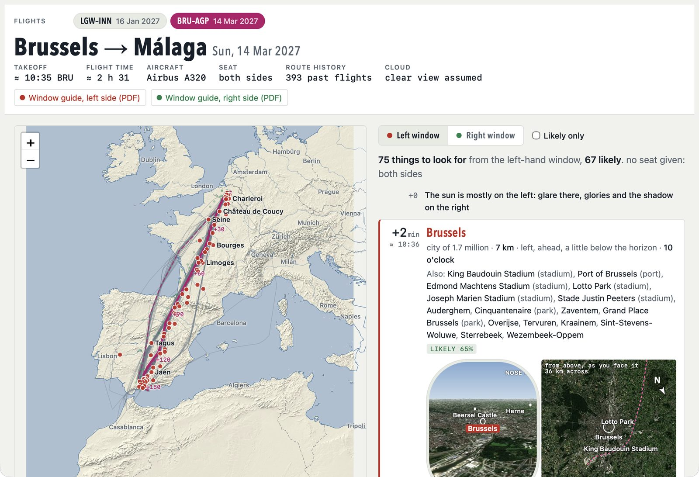
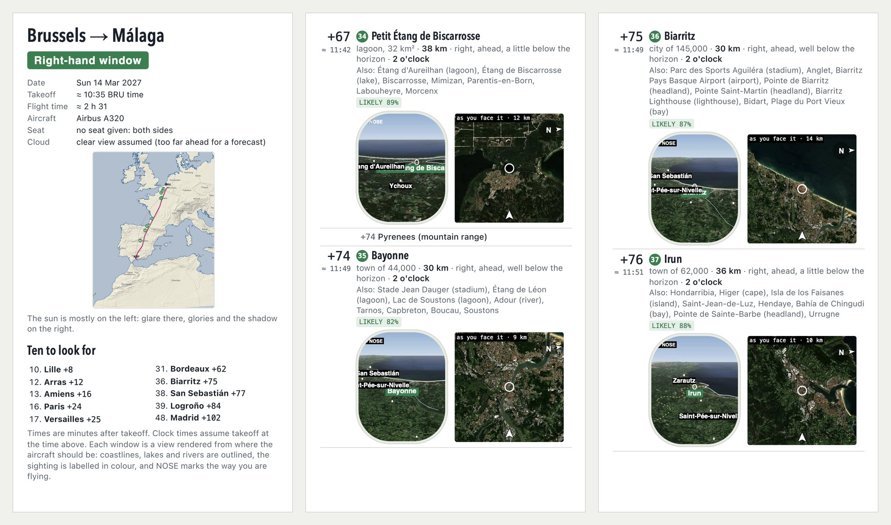

# The web page

Every forecast you make is added to one page, `site/index.html`, with a picker at the top to choose the flight.



## Opening it

Either double-click `site/index.html`, or serve the folder:

```bash
uv run planeview serve            # http://localhost:8765/
uv run planeview serve 9000       # another port
```

Both show the same page. Serving is for looking at it from another device on your network (use the computer's
address in place of `localhost`) or for a browser set up to restrict pages opened from files.

The page needs no network: the map library, the styles and the data are all in the folder.

## What is on it

- **The picker**: your flights, soonest first. The address ends in the flight's id (`index.html#2027-03-14-bru-agp`),
  so a link goes straight to one flight.
- **The facts**: takeoff time, flight time, aircraft, seat, how many past flights the forecast rests on, and
  the cloud outlook when the flight is within 15 days.
- **The route map**, north up: every variant, the past flights faintly behind, and a marker for each sighting.
  Drag and zoom it. Choosing a sighting in the timeline moves the map to it and names it; choosing a marker
  scrolls the timeline to that sighting.
- **The flight profile** under the map: daylight, height, and when each sighting comes, left window above the
  line and right window below. Its dots work like the map's markers.
- **The timeline**: choose **Left** or **Right**, and optionally **Likely only**. Each sighting has its time,
  direction ("2 o'clock, a little below the horizon"), distance, chance, the rendered **window view** and the
  **satellite image from above**, and what else is in view. Click the pictures to enlarge them. Between the
  sightings are coast and border crossings, top of climb and descent, sunrise and sunset.
- **The PDF guides** for each side, linked under the title when they were built.
- **How the forecast is made**, and the sources of the data with their dates.

The page remembers the side you chose. A forecast made with `--seat` opens on that seat's side.

## Rebuilding

```bash
uv run planeview site                              # index.html again, from every flight in site/f/
uv run planeview build out/2027-03-14_BRU-AGP      # one flight's pictures, page data and PDFs again, from its saved forecast
uv run planeview build out/* --no-pdf              # all of them, without the PDFs
uv run planeview build out/2027-03-14_BRU-AGP --pdf-only
```

`predict` does all of this itself; these are for after you update the code, or to re-make one part.

To remove a flight from the page, delete its folder in `site/f/` and run `planeview site`.

## What is in the folder

```
site/
  index.html           the page: one complete HTML file, styles included
  leaflet.js           the map library (Leaflet 1.9.4)
  flights.js           the picker's list
  f/<id>/
    data.js            the flight's data, as the page loads it
    data.json          the same data as plain JSON, for anything else that wants it
    relief.jpg         the map's background
    views-L.jpg  views-R.jpg      the window views for each side, as one sheet
    aerial-L.jpg aerial-R.jpg     the images from above
    guide-L.pdf  guide-R.pdf      the PDF guides
```

A flight is about 20 MB: half of it the two PDF guides, most of the rest the picture sheets.

The data is loaded with `<script>` tags, not `fetch`, which is what lets the page work when opened from a file.

## Putting it on the web

`site/` is a static site. Copy the whole folder to any web host and it works: there is nothing to run on the
server and no build step.

- **GitHub Pages**: put the contents of `site/` in a repository (or a `docs/` folder, or a `gh-pages` branch) and
  turn Pages on for it.
- **Netlify, Cloudflare Pages, S3 and the like**: upload the folder.
- **Your own server**: copy it into the web root.

Before publishing, mind the imagery's licence: the satellite pictures are CC BY-NC-SA 4.0, so the page may be
shared for non-commercial use with the attribution it already carries at the bottom. See
[data-sources.md](data-sources.md).

## The PDF guides



Two PDFs per flight, one for each side, sized for a phone screen (and readable printed):

- a cover: the route map, the facts and the ten best sightings;
- then a page for each half hour: a map of that stretch, and each sighting with its time, direction, chance and
  both pictures.

They are printed by a Chrome-family browser running without a window. If none is installed they are skipped and
everything else still works. If yours is somewhere unusual, set `PLANEVIEW_CHROME` to its path.
