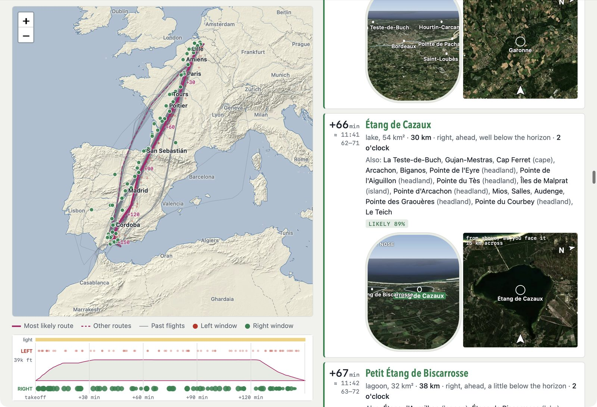
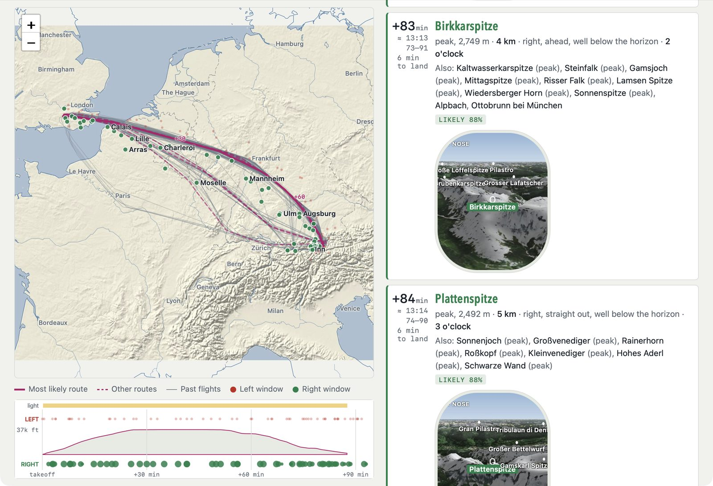
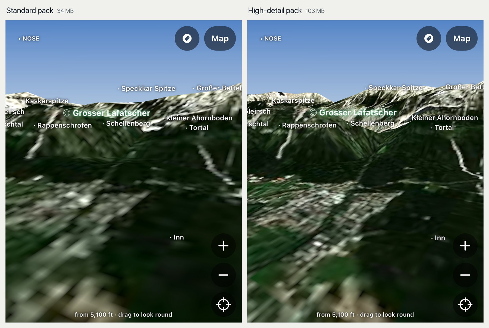
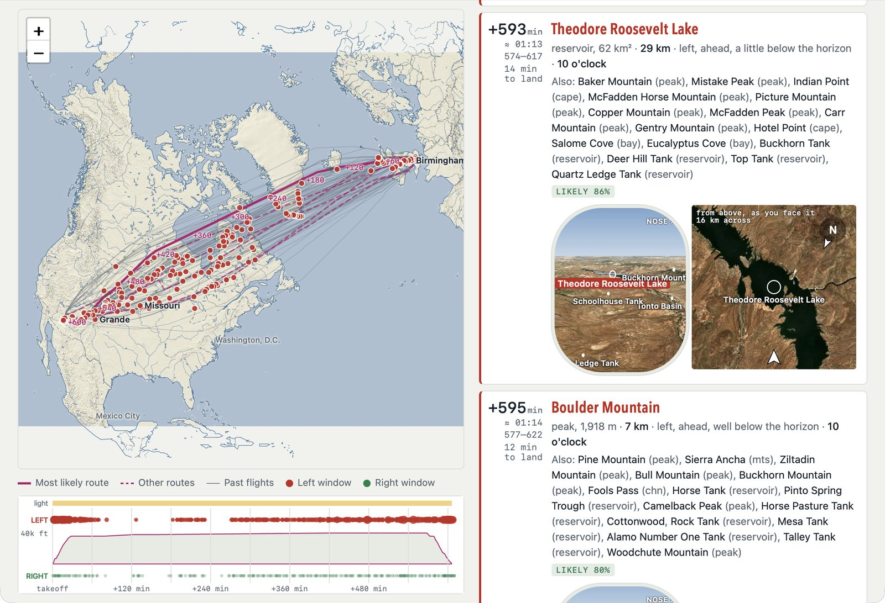

# Examples

Three forecasts made with plane-view, to show what it produces on different kinds of flight: a holiday route
over land and coast, a mountain approach, and a long-haul flight across an ocean.

They are invented flights on dates far enough ahead that no weather forecast exists, so a clear view is assumed.
Both sides of the aircraft are forecast.

| Flight | The page | Flight pack for the app |
|---|---|---|
| Brussels → Málaga, 14 March 2027 | [open](https://antimega.github.io/plane-view/#2027-03-14-bru-agp) | [2027-03-14_BRU-AGP.planeview](https://github.com/antimega/plane-view/releases/download/examples/2027-03-14_BRU-AGP.planeview) (70 MB) |
| London Gatwick → Innsbruck, 16 January 2027 | [open](https://antimega.github.io/plane-view/#2027-01-16-lgw-inn) | [2027-01-16_LGW-INN.planeview](https://github.com/antimega/plane-view/releases/download/examples/2027-01-16_LGW-INN.planeview) (34 MB), [high detail](https://github.com/antimega/plane-view/releases/download/examples/2027-01-16_LGW-INN-hd.planeview) (103 MB) |
| London Heathrow → Phoenix, 19 June 2027 | [open](https://antimega.github.io/plane-view/#2027-06-19-lhr-phx) | [2027-06-19_LHR-PHX.planeview](https://github.com/antimega/plane-view/releases/download/examples/2027-06-19_LHR-PHX.planeview) (369 MB) |

Each page links to its two PDF guides. To try a pack, build the app ([docs/app.md](../docs/app.md)), load the
file, and choose **Rehearse this flight** from the menu.

The imagery in the pages and packs is © EOX IT Services GmbH (EOxCloudless, contains modified Copernicus Sentinel
data 2024), CC BY-NC-SA 4.0. See [docs/data-sources.md](../docs/data-sources.md).

## 1. Brussels → Málaga

```bash
uv run planeview predict --date 2027-03-14 --from BRU --to AGP --dep 10:20
uv run planeview pack out/2027-03-14_BRU-AGP
```

**393 past flights**, six route variants. The likeliest (49%) leaves runway 25R, crosses France by Paris,
Limoges and the Landes, the Pyrenees near Pamplona, and Spain by Madrid's eastern side, landing on runway 12.
The second (25%) is the same route landing the other way, on runway 31, which swaps what each side sees in the
last ten minutes. 2 h 31 in the air.

75 sightings on the left and 73 on the right. A few of them:

| After takeoff | Side | What | Distance | Where to look | Chance |
|---|---|---|---|---|---|
| +2 min | left | Brussels, city of 1.7 million | 7 km | 10 o'clock, a little below the horizon | 65% |
| +8 min | right | Lille | 12 km | | 100% |
| +17 min | left | Château de Coucy, castle | 26 km | | 93% |
| +24 min | right | Paris | 27 km | | 81% |
| +33 min | left | The Loire | 30 km | | 100% |
| +62 min | right | Bordeaux and the Garonne | 28 km | | 88% |
| +66 min | right | Étang de Cazaux, lake behind the Atlantic dunes | 30 km | 2 o'clock, well below the horizon | 89% |
| +77 min | right | San Sebastián | 34 km | | 88% |
| +85 min | both | The Ebro | 30 km | | 100% |
| +102 min | right | Madrid | 25 km | | 87% |
| +128 min | left | Granada, under the Sierra Nevada | 15 km | | 72% |
| +142 min | left | Málaga | 12 km | | 84% |

Between them the timeline notes the border crossings, the top of climb (about 39,000 ft, 28 minutes in), the
Pyrenees, the Sierra Morena, the top of descent, and that the sun is mostly on the left.



**What it shows:** a well-flown route gives firm odds. Most sightings here are *likely*, because hundreds of
flights took nearly the same line. The lower numbers come at the end, where the two landing directions disagree.

## 2. London Gatwick → Innsbruck

```bash
uv run planeview predict --date 2027-01-16 --from LGW --to INN --dep 11:35
uv run planeview pack out/2027-01-16_LGW-INN
uv run planeview pack out/2027-01-16_LGW-INN --detail high
```

**148 past flights**, six variants, 1 h 33 in the air. The route runs over Belgium and southern Germany to the
Bavarian lakes, then drops into the Inn valley.

The last fifteen minutes are the point of this one. Below 7,000 m the forecast tests every line of sight against
the terrain, so what it lists are the peaks that stand beside the aircraft, not the valleys hidden behind them:

| After takeoff | Side | What | Distance | Chance |
|---|---|---|---|---|
| +26 min | left | Antwerp | 37 km | 95% |
| +50 min | right | Mannheim, then Heidelberg | 41 km | 77% |
| +65 min | left | The Danube, at Ingolstadt | 24 km | 100% |
| +71 min | left | Munich | 15 km | 66% |
| +74 min | right | Lake Starnberg | 18 km | 81% |
| +76 min | left | Chiemsee | 52 km | 83% |
| +78 min | right | Schafreuter, peak | 4 km | 86% |
| +79 min | left | Kufstein Fortress | 25 km | 82% |
| +83 min | right | Birkkarspitze, 2,749 m, the highest of the Karwendel | 4 km | 88% |
| +85 min | left | Hirzer and the Tux Alps | 7 km | 88% |
| +88 min | right | Rum and Thaur, villages under the Nordkette | 1 to 2 km | about 80% |
| +91 min | left | Innsbruck | 1 km | 90% |

It is January, so the window views have snow above the snowline.



**What it shows:** terrain. Of the 148 past flights, 127 have an end that no receiver heard: an aircraft low in
the valley is hidden by its walls. plane-view continues each of those in a straight line to the runway, which is
why the villages beside the airport are in the forecast at all.

This is also the flight to try `--detail high` on. The app's 3D view of the Inn valley is far better with the
finer terrain, on a phone as much as on an iPad:



[docs/flight-packs.md](../docs/flight-packs.md#what-the-difference-looks-like) compares the two packs picture by
picture, and [docs/app.md](../docs/app.md#on-an-ipad) shows this flight on an iPad.

## 3. London Heathrow → Phoenix

```bash
uv run planeview landmarks --from LHR --to PHX          # optional, an hour or more: see below
uv run planeview predict --date 2027-06-19 --from LHR --to PHX --dep 15:05
uv run planeview pack out/2027-06-19_LHR-PHX
```

**96 past flights**, of which only 3 were heard from end to end: the other 93 were joined across the gap where
no receiver reaches. Six variants, the likeliest at 29%: on a route this long, the day's winds decide whether it
goes over Iceland and Greenland or further south, so the odds for anything in the middle of the flight are
modest. 10 h 10 in the air, in daylight all the way in June.

| After takeoff | Side | What | Chance |
|---|---|---|---|
| +3 min | left | The Thames, Windsor Castle among the "also in view" | 97% |
| +15 min | left | Birmingham | 81% |
| +23 min | right | Leeds | 81% |
| +34 min | left | The Isle of Man | 52% |
| +59 min | | The Outer Hebrides | |
| +2 h 03 | | Iceland | |
| +3 h 00 | | Greenland's east coast, then about 50 minutes over the ice | |
| +4 h 24 | | Baffin Island, Hudson Strait, Hudson Bay | |
| +7 h 58 | left | The Missouri | 73% |
| +8 h 53 | left | The Arkansas river, in the Colorado Rockies | 80% |
| +9 h 38 | left | The Little Colorado | 95% |
| +9 h 53 | left | Theodore Roosevelt Lake | 86% |
| +9 h 58 | left | Stewart Mountain Dam, on the Salt River | 90% |
| +10 h 02 | right | Phoenix | 59% |
| +10 h 03 | left | Mesa and Tempe | 99% |



**What it shows:** the limits. The rows without a side or a chance are context, not sightings: over the ocean
and the Arctic the forecast can say where you are but there is little that is named, and which side it is on
depends on the day's track. There are more than 210 sightings a side all the same; the likely ones are all in the first
half hour and the last three hours.

**Landmarks on a long route.** A forecast fetches landmarks for 120 map cells at a time, nearest the airports
first. This route crosses about 2,300, so the first forecast has landmarks at each end and place names only in
between. `planeview landmarks --from LHR --to PHX` fetches the rest in one sitting.

## Making them yourself

The commands above are all there is to it, once you have flight history for the route. These examples used a
library of **70 days spread over a year** (17 November 2025 to 15 November 2026, about one day in five), which
is what gives Innsbruck its winter flights and Phoenix its 96:

```bash
uv run planeview history add 2025-11-17..2026-11-15/5      # 73 days: about five hours, 2.7 GB kept
```

You do not need that much to get close. A fortnight of recent days gives Brussels to Málaga dozens of past
flights and much the same forecast. Innsbruck needs winter days, because most of its flights are seasonal.
Phoenix, flown once or twice a day, improves with every day you add.

Your results will differ a little from these in any case: the past flights you hold will not be the same ones.

[`build.sh`](build.sh) runs all three forecasts and packs in one go.
